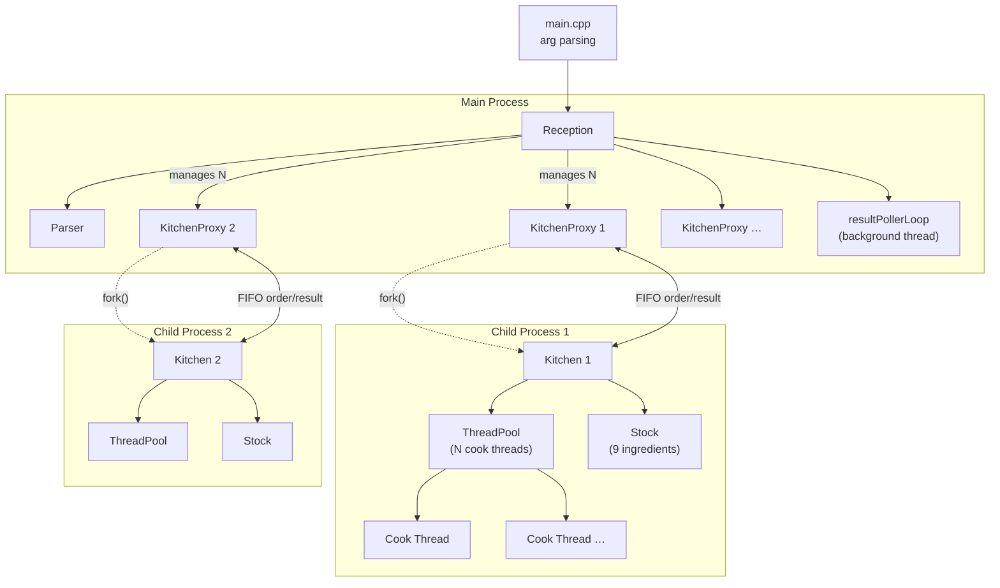
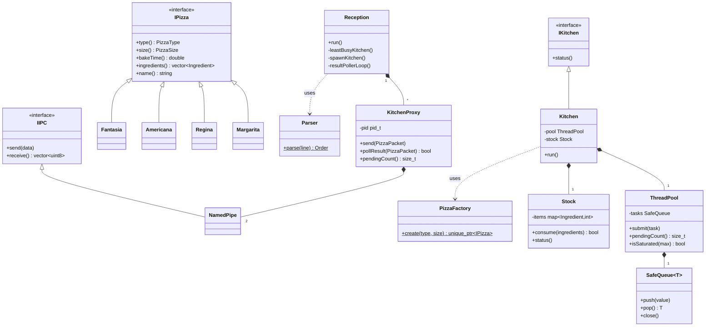
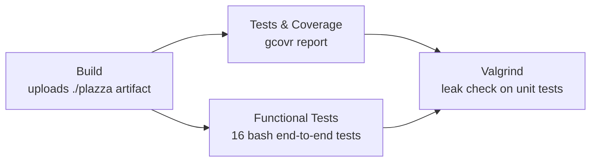

# Plazza — Architecture

## Process Architecture



---

## Order Lifecycle

```mermaid
sequenceDiagram
    actor User
    participant Reception
    participant Parser
    participant KitchenProxy
    participant Kitchen
    participant ThreadPool
    participant Stock

    User->>Reception: "margarita S x2; regina M x1"
    Reception->>Parser: parse(line)
    Parser-->>Reception: [(Margarita,S),(Margarita,S),(Regina,M)]

    loop for each pizza
        Reception->>KitchenProxy: send(PizzaPacket{type,size,orderId})
        KitchenProxy->>Kitchen: write to order FIFO
        Kitchen->>ThreadPool: submit(cookPizza)
        ThreadPool->>Stock: consume(ingredients)
        Stock-->>ThreadPool: ok
        Note over ThreadPool: sleep(bakeTime × multiplier)
        ThreadPool->>Kitchen: write result to result FIFO
        Kitchen-->>KitchenProxy: result FIFO readable
        KitchenProxy-->>Reception: pollResult() → PizzaPacket
        Reception-->>User: "Order #N (Margarita S) is ready!"
    end
```

---

## Class Hierarchy



---

## Kitchen Lifecycle

```mermaid
stateDiagram-v2
    [*]      --> Idle    : fork() + Kitchen::run() starts
    Idle     --> Active  : order received via FIFO
    Active   --> Active  : more orders / pendingCount > 0
    Active   --> Idle    : pendingCount == 0
    Idle     --> [*]     : 5 s idle timeout → exit(0)
```

---

## CI/CD Pipeline


